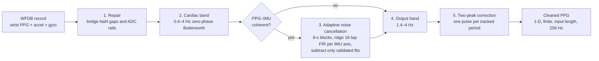

<div align="center">

# Wrist PPG Motion-Artifact Cleaning

**Cleans motion-contaminated wrist PPG using the co-located accelerometer and gyroscope,<br>
through IMU-referenced adaptive noise cancellation with zero-phase filtering.**


[Method and results](method.md) · [WRIST dataset](https://physionet.org/content/wrist/1.0.0/)

</div>

---

## Overview

`run_inference.py` is a classical signal-processing cleaner. It takes raw wrist PPG plus the wrist
accelerometer and gyroscope channels and returns the cleaned PPG: a 1-D array with exactly the input
length on the original 256 Hz grid. The motion sensors predict the artifact in the PPG, and the
prediction is subtracted, but only where the fit is shown to transfer out of sample.

The cleaner reads only the wrist PPG and IMU channels. It does not use record names or activity labels,
needs no training, pre-trained models or network access, and always returns a finite waveform derived
from the recorded PPG (never beat indices or templates).

## Results

Beat detection against the reference beat times, F1 within ±150 ms. All tuning used the development
subjects s1–s6; s8 and s9 were set aside **before** tuning and never used to choose any setting.

| Mean F1 (±150 ms) | Walk | Run | Bike low | Bike high | All development | Holdout (s8, s9) |
|---|---|---|---|---|---|---|
| Raw PPG | 0.435 | 0.572 | 0.401 | 0.295 | 0.432 | – |
| **This cleaner** | **0.439** | **0.666** | **0.643** | **0.706** | **0.610** | **0.460** |

- The 1.4–4 Hz output band alone takes raw PPG from 0.432 to 0.590 mean F1, the largest single gain.
- Switching adaptive noise cancellation off costs the s3 run 18 F1 points.
- Detected peaks show no systematic offset: the median error is −12 ms, and no constant shift improves F1.

The full analysis, including every change that was tested and rejected, is in [method.md](method.md).

## How it works



1. **Repair.** Channels are selected by name. PPG samples that are non-finite, or stuck at one value for
   0.1 s or more (an ADC rail), are bridged by linear interpolation on the existing time grid.
2. **Cardiac band.** PPG and IMU are band-passed to 0.4–4 Hz with a zero-phase, order-3 Butterworth.
3. **Adaptive noise cancellation.** In overlapping 8-s blocks, a ridge-regularised 16-tap FIR model per
   IMU axis predicts the motion part of the PPG. The prediction is subtracted only if the fit transfers
   to held-out 1-s chunks of the same block and does not explain almost the whole block. Cancellation is
   skipped for the whole record if the PPG and IMU are not coherent.
4. **Output band.** The signal is band-passed to 1.4–4 Hz to remove the remaining low-frequency motion
   (0.5–4 Hz when a clean, low-rate pulse ridge that the IMU does not share is detected).
5. **Two-peak correction.** At low pulse rates the 1.4 Hz edge can split one pulse into two bumps. The
   local pulse period is tracked each second from the PPG spectrum, with IMU-dominated bins
   down-weighted; when two peaks are closer than half a period, the smaller one is flattened with a
   smooth bridge. Peaks are never merged if they are more than 0.34 s apart or if the pulse track is not
   confident.

## Getting started

### Install

```bash
git clone https://github.com/Aman-Tripathi27/ppg-motion-artifact-cleaning.git
cd ppg-motion-artifact-cleaning
pip install -r requirements.txt        # pinned: numpy, scipy, wfdb (Python 3.13)
```

Download the [WRIST dataset](https://physionet.org/content/wrist/1.0.0/) from PhysioNet (ODC-BY 1.0).

### Command line

```bash
python run_inference.py <record> <output.npy|output.csv>
```

`<record>` is a WFDB record path from the WRIST dataset, with or without `.hea`. The output is the
cleaned PPG as a 1-D array (`.npy`) or a single-column `.csv`, with the same length as the input,
sampled at 256 Hz.

```bash
python run_inference.py wrist/1.0.0/s1_walk cleaned_s1_walk.npy
```

### Python API

```python
import wfdb
from run_inference import clean_ppg

record = wfdb.rdrecord("wrist/1.0.0/s1_walk", physical=True)
cleaned = clean_ppg(record.p_signal, record.sig_name, float(record.fs))   # 1-D, finite, 256 Hz
```

`clean_ppg(samples, channel_names, sampling_rate=256.0)` expects 256 Hz input and raises `ValueError`
otherwise.

## Robustness and output contract

| Guarantee | Detail |
|---|---|
| Output shape | 1-D, exactly the input length, on the original 256 Hz grid |
| Always finite | NaN gaps, flat sensors and ADC rails are repaired; the output contains no NaN or inf |
| Tolerant inputs | Missing or reordered IMU channels are handled; absent channels are skipped rather than fatal |
| Zero-phase | Forward-backward filtering throughout, so peaks are not delayed |
| Deterministic | No training, no randomness, no network access |
| Fast | A 5-minute record takes about 0.34 s on a laptop CPU |

## Repository structure

```text
ppg-motion-artifact-cleaning/
├── run_inference.py   # the cleaner: command-line tool and clean_ppg() API
├── method.md          # method, key decisions, tested-and-rejected ideas, results
└── requirements.txt   # pinned dependencies
```

## Limitations

- Walking is the weakest activity, because arm swing near the pulse rate is only partly removed.
- On some records the offset between detected peaks and the reference timing drifts steadily over the
  recording, for example from −74 to −176 ms on s9_walk. This looks like clock drift between the
  recording devices, and no cleaning step can correct it.
- The holdout is two subjects, so its F1 has wide uncertainty.

## References

- Jarchi, D. and Casson, A. J. (2017). Description of a Database Containing Wrist PPG Signals Recorded
  during Physical Exercise with Both Accelerometer and Gyroscope Measures of Motion. *Data*, 2(1).
  [doi:10.3390/data2010001](https://doi.org/10.3390/data2010001)
- Wrist PPG During Exercise (WRIST) v1.0.0, PhysioNet, <https://physionet.org/content/wrist/1.0.0/> (ODC-BY 1.0).
- Goldberger, A. L. et al. (2000). PhysioBank, PhysioToolkit, and PhysioNet. *Circulation*, 101(23), e215–e220.

---

<div align="center">
<sub>Built by <a href="https://github.com/Aman-Tripathi27">Aman Tripathi</a> · <a href="https://amantripathii.netlify.app">Portfolio</a> · <a href="https://www.linkedin.com/in/aman-tripathi27/">LinkedIn</a></sub>
</div>
